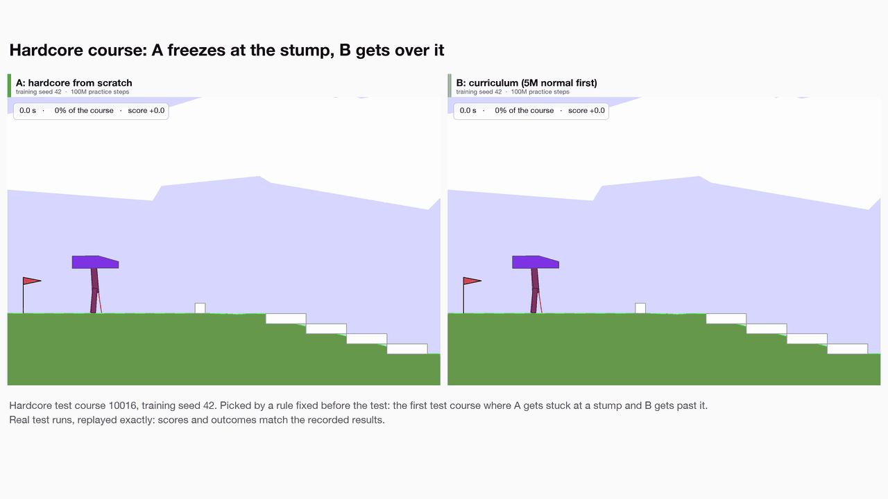
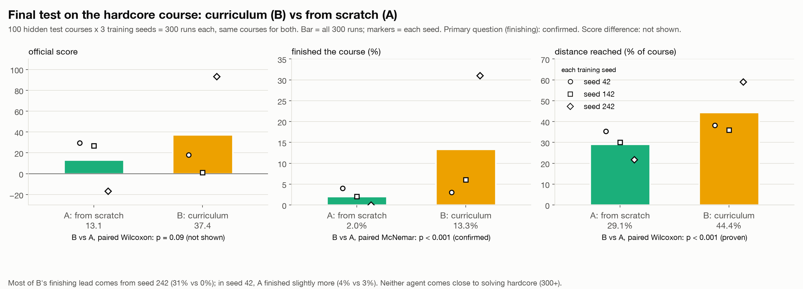
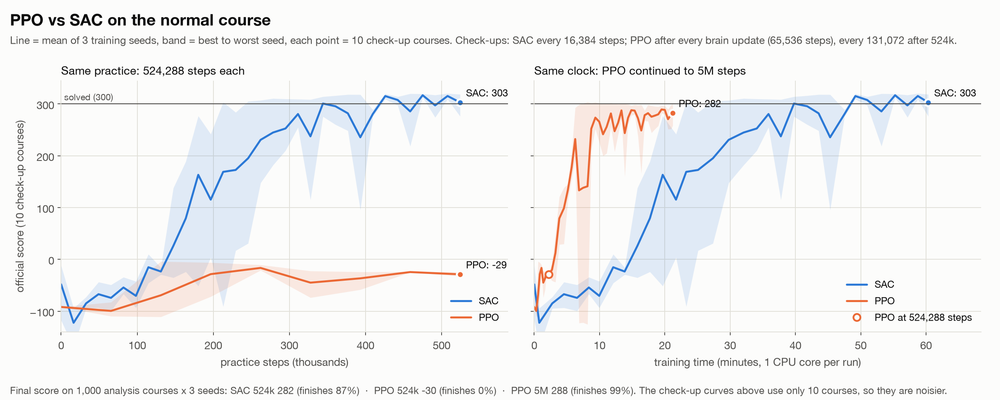
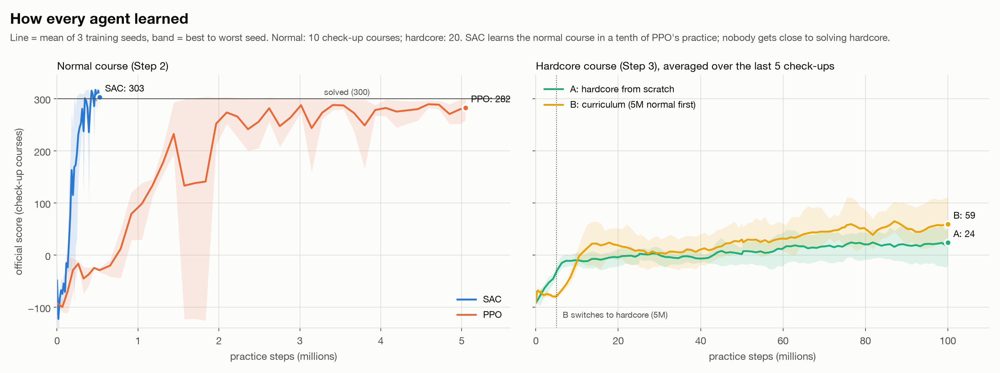
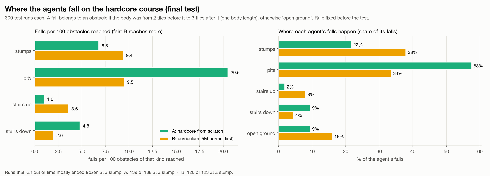

# Robot Walker: does learning to walk first help a robot learn an obstacle course?

A two-legged robot (Gymnasium's **BipedalWalker**) teaches itself to walk with reinforcement learning, then takes on the **hardcore** course full of stumps, pits and stairs.

The main experiment asks one question: **with exactly the same amount of practice, does a curriculum (flat ground first, then obstacles) beat training on obstacles from scratch?**



*Same hidden test course, same training seed. Left: A, trained on obstacles from scratch, stops at a stump and never moves again. Right: B, which learned to walk on flat ground first, climbs over the stump, then freezes at the next one. Real test runs, replayed exactly.*

---

## Results at a glance

On the **final test** (100 hidden hardcore courses × 3 training seeds = 300 runs per agent, run exactly once):

| | A: hardcore from scratch | B: curriculum (5M flat, then 95M hardcore) |
|---|---|---|
| Score (official) | 13.1 | 37.4 |
| **Finished the course** | **2.0%** | **13.3%** |
| Fell | 35.3% | 45.7% |
| Ran out of time | 62.7% | 41.0% |
| Distance reached | 29.1% | 44.4% |
| Practice | 100,007,936 steps | 100,007,936 steps |

- **B finishes more often. Confirmed** by the rule written down before the test: B finished 39 courses that A didn't, A finished 5 that B didn't (paired McNemar test, p < 0.001).
- **B gets further. Proven:** +15.3 points of the course (Wilcoxon signed-rank, p < 0.001).
- **B's higher average score is not proven:** p = 0.09, and B scored *lower* in 2 of the 3 seeds.
- **Honest caveat:** most of B's finishing lead comes from one training seed (31% vs 0%). In another seed, A finished slightly more (4% vs 3%). With 3 training runs per agent, the curriculum clearly helped *these* robots. It can't promise the same gain for every new training run.
- **Neither agent learned hardcore well.** The RL Baselines3 Zoo's published PPO agent scored 122 after the same 100M steps; our from-scratch agent scored 13. (That's a rough comparison only: their single agent, on their own courses.)

The first experiment compared the two algorithms on the flat course:
- **SAC learned to walk with a tenth of PPO's practice.** At 524k steps, SAC finished 85% of test courses; PPO was still standing still.
- **PPO learned faster per minute on this laptop.** Given 5M steps, which took a third of SAC's training time, PPO finished 99.3%.

All six predictions written in the [test plan](TEST_PLAN.md) before the final test held up.



---

## How this was built

Built over about two days (October 16–17, 2026) on a MacBook Air: Apple M2, 16 GB, **CPU only, no GPU**, using at most 4 cores because the Mac was shared with another job.

**Workflow:** I directed the project. I chose the experiments, made every decision, and set the fairness rules before the results came in. Nothing moved to the next step until I had reviewed the result and made the call. The decisions I made along the way:
- **Fairness rules, set up front:**
  - Equal practice for every compared agent, 3 training seeds each.
  - Separate courses for checking, analysing and the final test, with the test hidden until the end and used once.
  - Paired statistical tests; nothing called "proven" without one.
  - Bad results reported as clearly as good ones.
- **Which algorithm to scale up:** PPO, even though SAC won at equal practice. On this laptop PPO practises 27× more steps per second, and the Zoo's own results show SAC barely learns hardcore.
- **The budget:** 100M steps per agent, matching the Zoo's PPO budget so the result can be compared with theirs.
- **The setup:** the same Zoo hardcore settings for both agents, and B's split of 5M flat + 95M hardcore.
- **Continuing after the safety check failed** for 2 of 3 seeds, and documenting it ([below](#a-safety-check-that-failed)).
- **Skipping an optional third agent,** and choosing both fixes from the mid-project review.
- **Testing with "average" moves,** and approving the final test plan before it ran.

**By the numbers**
- **617 million** practice steps across 13 training runs. The two 100M-step agents trained for 6.2 h (A) and 7.9 h (B), 3 seeds side by side.
- **61,000** evaluation episodes, including 33,000 on analysis courses and a 2,400-run final test that took 3.5 minutes.
- **14** 4K videos, each replaying a recorded test run, checked to match its score exactly.
- About **2,900 lines** of Python in 15 scripts.

**Techniques**
- **Deep reinforcement learning:**
  - PPO and SAC (Stable-Baselines3, PyTorch) with RL Baselines3 Zoo hyperparameters.
  - Observation and reward normalization (saved with every model and loaded for every test).
- **Curriculum learning:** a two-phase training run that continues the same brain, optimizer and normalization stats on a new course, with the learning-rate schedule measured over the whole run (Stable-Baselines3's own schedule restarts each time training resumes).
- **Rigorous evaluation:**
  - Separate validation, analysis and test courses; McNemar's exact test and the Wilcoxon signed-rank test on paired runs.
  - A test plan with a verdict rule and written predictions, committed to git before the one-shot final test.
  - A script that refuses to run the test twice or with uncommitted files.
- **Reproducibility:**
  - Found and fixed a bug where results depended on which courses ran before (the physics engine reused its world). After the fix, training is bit-for-bit reproducible, and a fresh install from `requirements.txt` reproduces a final-test score exactly, to every printed digit.
- **Failure analysis:** where each agent falls (per obstacle reached), whether it freezes, how it walks (gait measurements from the physics).
- **Visualization:**
  - Colourblind-validated charts.
  - The game re-drawn as vector graphics at 5.4× for 4K video, with a clean (no-text) version of every clip for editing.

---

## The setup, in plain words

- **The robot** has 4 motors (2 hips, 2 knees). Every 1/50 of a second it sees 24 numbers:
  - body tilt and speed
  - joint angles and speeds
  - whether each foot touches the ground
  - 10 "lidar" distance rays that look at the ground ahead
- **The score** is the game's official reward:
  - About +300 for walking to the end of the course.
  - −100 for falling (the body touches the ground).
  - A small cost for every bit of motor use.
  - A course counts as **solved** at an average of 300+.
- **The normal course** is gently rolling ground (32 s to finish). **The hardcore course** adds 10–19 obstacles per course: stumps to step over, pits to cross, and stairs up and down (40 s).
- **How a robot learns:** it tries moves, gets the score as feedback, and slowly adjusts its "brain" (a small neural network) to do more of what scored well.
- **The two learning methods:**
  - **PPO** learns only from fresh practice and then throws it away.
  - **SAC** keeps a memory of past moments and keeps re-learning from them.
- **Fairness:**
  - Every compared agent gets the same number of practice steps and the same 3 training seeds (42, 142, 242).
  - Course seed *s* always builds exactly the same course, so two agents can be compared on identical courses.
  - Courses are split into separate sets: validation 5000–5099, analysis 20000+, and the hidden test 10000–10099, used once at the end.

---

## Step 1 → 2: PPO vs SAC on the normal course

Both algorithms got exactly 524,288 practice steps (3 seeds each), and PPO was also continued to 5M steps.

| Final test, normal course (300 runs each) | Score | Finished | Training time per seed |
|---|---|---|---|
| SAC, 524k steps | 274.9 | 85.3% | 60 min |
| PPO, 524k steps | −30.6 | 0% (stands still) | 2 min |
| PPO, 5M steps | 288.4 | 99.3% | 21 min |

- **Same practice:** SAC is far better (finished 256 courses vs 0, p < 0.001).
  - In 524k steps SAC makes 524,288 small brain updates, each re-using old experience. PPO makes only 8 big ones.
  - PPO was stuck in a **"freeze" trap:** standing still until time runs out scores about −30, which beats falling (−100).
- **Same clock:** PPO practises 27× more steps per second.
  - With 5M steps (still only a third of SAC's training time), PPO finishes more courses than SAC (p < 0.001).
  - But SAC walks about 1.6× faster and scores higher when both finish.
- One SAC seed solved the normal course (307.8). PPO's best seed reached 299.6.



---

## Step 3: from scratch (A) vs curriculum (B) on the hardcore course

- **A** practised on the hardcore course for 100,007,936 steps.
- **B** practised on the normal course for 5,013,504 steps, then on hardcore for 94,994,432 steps: the same total.
- **Everything else is identical:** settings (the Zoo's PPO hardcore settings), seeds, and starting brain (checked: all weights equal at step 0).
- **B keeps everything when it switches courses:** brain, optimizer memory, and normalization stats.



### A safety check that failed
Before training, we agreed on a rule: B moves on to hardcore only if every seed finishes at least 90% of the 100 normal validation courses after its 5M flat-ground steps. **It failed for 2 of 3 seeds:**

| Seed | Normal validation score | Finished | Fell | Distance | First 10-course check-up with 90%+ finished |
|---|---|---|---|---|---|
| 42 | 301.5 | **99%** (pass) | 1% | 99.8% | 1.8M steps |
| 142 | 258.5 | **81%** (fail) | 19% | 91.8% | 1.6M steps |
| 242 | 247.4 | **78%** (fail) | 22% | 89.5% | 1.0M steps |

**We continued anyway.** All three seeds had clearly learned to walk: each hit 90%+ on a check-up earlier in training. The drop at 5M looked like normal swings from the still-high learning speed, a likely reason we didn't test. So 2 of the 3 B walkers started hardcore as 78–81% reliable walkers, not 90%+.

### What the robots actually do



- **Both agents learned to "freeze" at stumps.** When a run ran out of time, the robot had almost always stopped at a stump: A in 139 of its 188 timeouts, B in 120 of 123.
  - In a check of 60 such runs per agent, the robot was completely motionless for the last 10 seconds in 56 (A) and 53 (B), standing in front of the stump or straddling it.
  - It's the same trap as before. Standing still costs a little, falling costs 100.
  - Testing with randomized moves instead of "average" ones didn't break the freeze. It just turned some freezes into falls, and made both agents score worse.
- **Pits are A's main killer:** 20.5 falls per 100 pits reached, vs 9.5 for B. B's falls are split between stumps and pits.
- **On their own, obstacles look passable,** but a course has about 13 and the risks multiply. On the analysis courses, B got past 92% of the pits it reached (A 77%) and 83% of the stumps (A 77%).
- **Different gaits:**
  - **SAC** "scurries": level body, quick even steps, the fastest.
  - **PPO** and **A** move in a lopsided way, with one leg held out straight in front like a feeler while the other does most of the steps.
  - **B** strides with both legs and works its motors the hardest.
- **On the flat course** A and B walk about equally well (both finish about 90%). A, which never practised on flat ground, walks it fine; B didn't forget how.

---

## Bugs found along the way
1. **Results depended on which courses ran before.**
   - The game reuses one physics world for every episode, and leftover bookkeeping nudged later episodes. The hand-written walker scored differently on 6 of 10 courses just by running them in reverse order.
   - Fixed by starting every episode in a fresh physics world. A permanent check guards it.
2. **The obstacle detector** counted every stair step as its own staircase, because the game stores the course finish-to-start.
3. **Stable-Baselines3's shrinking learning rate restarts every time training resumes,** e.g. at a save point or when B switches courses. Fixed so it shrinks over the whole run.
4. **The fall labels were too narrow.** Falls while landing just after a stump or pit were called "flat ground". The window was widened to one body length after an obstacle, **before** the final test.
5. **"Where a stuck robot got stuck" was judged from its furthest point,** which blames the next obstacle when a robot gets past an obstacle's edge and slides back.
   - Found *after* the test, when a video titled "A freezes at the stump" showed A stuck in a pit.
   - Fixed to use where the run ended. It changes A's "stuck at a stump" count from 145 to 139 of 188. The recorded test results file is kept unchanged, and the clip was re-picked by the same rule (details in [TEST_PLAN.md](TEST_PLAN.md), section 7).

## Limits, honestly
- **3 training seeds per agent,** and B's finishing lead leans heavily on one of them.
- **The final test is 100 courses per seed.**
- **Neither agent comes close to solving hardcore,** and both are far below the Zoo's published PPO agent. We haven't tested why. Our A seeds alone ranged from −17 to 30.
- **One fixed budget (100M) and one curriculum split (5M)** were tried. A gradual curriculum was considered and skipped.
- **B's safety check failed for 2 of 3 seeds** (see above).
- **Everything was tested with each robot's "average" move,** as the Zoo's benchmark does.

---

## Videos
All in `videos/final/`: 3840×2160, 50 fps, H.264.
- **Picked by rules written down before the test.**
- **Checked:** each replays a recorded final-test run, and was only kept if it matched its recorded score exactly ([manifest](videos/final/manifest.json)).
- **Two versions:** most clips come labelled and as `_clean` (no text).

| Clip | What happens |
|---|---|
| [`collapse_to_walking.mp4`](videos/final/collapse_to_walking.mp4) | The untrained robot topples in 2.3 s → after 229k steps SAC wobbles forward → after 524k steps it walks and finishes in 15.9 s |
| [`a_freezes_b_gets_past.mp4`](videos/final/a_freezes_b_gets_past.mp4) | A freezes at a stump for the rest of the run; B climbs over it, then freezes at the next one |
| [`a_vs_b_hardcore.mp4`](videos/final/a_vs_b_hardcore.mp4) | Same course: A falls at 8.7 s; B finishes in 27.4 s (chosen to illustrate the main result, and labelled so) |
| `broll_1` … `broll_5` | B finishing hardcore, A falling into a pit, B falling at a stump, PPO's lurching walk, A's one-leg hop |
| `untrained_…`, `sac_229k_…`, `sac_524k_normal_clean.mp4` | The three stages of "collapse to walking" as separate clean clips |

The Step 4 review clips (on analysis courses) are in `videos/`.

---

## How to run it

```bash
brew install python@3.11 swig ffmpeg
python3.11 -m venv .venv && .venv/bin/pip install -r requirements.txt
.venv/bin/python check_setup.py                      # sanity checks (~10 s)
```

Re-running everything (times on an M2 MacBook Air, 3 seeds side by side):

| What | Command | Time |
|---|---|---|
| PPO vs SAC | `train.py --run ppo`, `train.py --run sac` | 25 min + 65 min |
| Curriculum agent B | `train.py --run b --phase 1`, `gate.py`, `train.py --run b --phase 2` | ~8.5 h |
| From-scratch agent A | `train.py --run a` | ~6.5 h |
| Comparisons on analysis courses | `compare.py --models a_100m b_100m --course hardcore --name step3` | ~10 min |
| Final test (once only) | `final_eval.py` (refuses to run twice) | ~4 min |
| Charts / videos | `make_charts.py`, `make_videos.py final` | seconds / ~20 min |

The trained models are included in `models/`, so tests, charts and videos can be re-made without training.

## Project layout

| File | What it does |
|---|---|
| `config.py` | Every setting: courses, seeds, algorithm settings, budgets, fairness rules |
| `walker_env.py` | Builds a course and judges each run: finished / fell / backed off / timed out, distance, where it fell |
| `train.py` | Trains a run (all seeds side by side), including B's two phases |
| `evaluate.py` | Loads a model (always with its normalization stats) and runs it on chosen courses |
| `compare.py` | Paired comparisons on the analysis courses |
| `final_eval.py`, `TEST_PLAN.md` | The one-time final test, and its plan committed before it ran |
| `falls.py`, `review.py` | Where agents fall and get stuck; gait measurements |
| `make_charts.py`, `make_videos.py`, `render.py` | Charts; videos that replay recorded runs; the sharp re-renderer |
| `check_setup.py`, `benchmark_speed.py`, `gate.py`, `make_untrained.py` | Sanity checks, speed tests, B's safety check, the untrained robot |
| `models/`, `runs/`, `charts/`, `videos/` | Trained models, every log and result, charts, videos |
| `PROGRESS.md` | The full lab notebook: every step, decision and number |
| `INTERVIEW.md` | Ten questions about the project, answered plainly |

## Credits
- **The simulator:** [Gymnasium](https://gymnasium.farama.org/)'s BipedalWalker by the Farama Foundation, running on the Box2D physics engine.
- **Learning algorithms:** [Stable-Baselines3](https://github.com/DLR-RM/stable-baselines3).
- **Hyperparameters and the 122 benchmark:** [RL Baselines3 Zoo](https://github.com/DLR-RM/rl-baselines3-zoo).

## License
[MIT](LICENSE) © 2026 Saad Hilal
